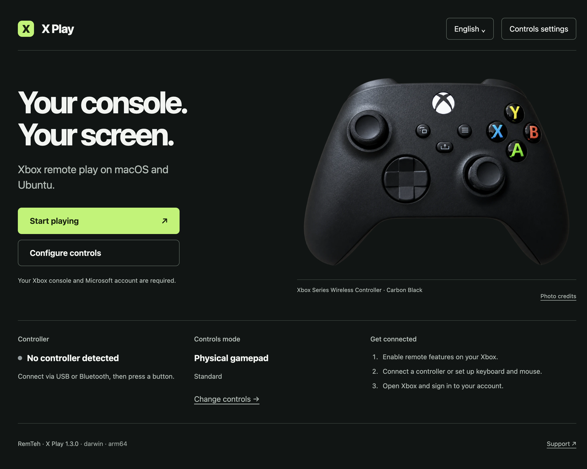

# X Play 1.3.0 preview

Independent Xbox Remote Play launcher for Apple Silicon macOS and Ubuntu ARM64. The **1.3.0 preview is published** with launcher/profile checks on Switch Ubuntu; Xbox gameplay acceptance remains pending. The ARM64 DMG is ad-hoc signed, not notarized. Public release 1.0.0 is retained as a historical version. See [actual releases](https://github.com/remteh-by/x-portal/releases) and the [site](https://remteh-by.github.io/x-portal/).

[Download 1.3.0 ARM64 DMG](https://github.com/remteh-by/x-portal/releases/download/v1.3.0/X-Play-1.3.0-arm64.dmg) · [Checksums and source](https://github.com/remteh-by/x-portal/releases/tag/v1.3.0)



## What changed in 1.3.0

A library of up to 50 named profiles: create, copy, select, edit, delete and import/export a complete library. Import requires review, including microphone behavior. Unsaved drafts survive Escape and closing until the user chooses. Existing controls-v1.json is preserved; unreadable library data is backed up before an explicit replacement. Each game window keeps its selected profile until it closes.

[Ubuntu ARM64 ZIP](https://github.com/remteh-by/x-portal/releases/download/v1.3.0/X-Play-1.3.0-linux-arm64.zip) · [All packages and SHA-256](https://github.com/remteh-by/x-portal/releases/tag/v1.3.0)

## Interface

A responsive graphite/lime launcher, persistent language selection, clear controller/profile state and accessible dialogs. A genuine Xbox Series controller photograph is shown as a transparent cutout; see [image sources and licenses](PHOTO-CREDITS.md). The optional support dialog opens the existing RemTeh Ko-fi page in the system browser.

## Controls / управление

Open Controls settings to choose physical gamepad or keyboard/mouse mode. Create or copy a named profile, choose it from the library, change sensitivity/inversion and assign keys. JSON export/import is limited to the validated schema. Settings apply to the **next game window**; the app does not claim to alter an existing stream silently.

В режиме клавиатуры/мыши нажмите отдельную кнопку захвата на странице игры. Escape освобождает курсор; он не назначается игровой кнопке. Физические геймпады сохраняются в Gamepad API. Потеря фокуса, скрытие окна, переход в текстовое поле и потеря pointer lock очищают виртуальный ввод. В режиме физического геймпада API не подменяется.

Default keys: WASD movement, mouse look, left/right mouse RT/LT, Space A, Q B, E X, R Y, F/G shoulders, Tab View, Enter Menu, Shift/Control stick clicks. Profile import rejects duplicate or unsupported keys. Microphone requests are disabled unless enabled explicitly in the profile.

## Security and limits

Electron renderer sandbox and context isolation are enabled; Node integration is off. Local launcher IPC validates the sending frame. Game navigation is limited to explicit HTTPS Xbox/Microsoft sign-in hosts. Remote pages receive only the validated controls configuration through an isolated preload; they do not receive a general Electron bridge.

Remote Play still depends on Xbox service/account/network requirements. The keyboard adapter uses browser Gamepad API behavior and needs verification in actual games. It does not guarantee all games, 4K, zero latency, Intel Mac support or compatibility with future sign-in routes. Windows, Android and Intel Mac packages are not provided. Ubuntu ARM64 has a native ZIP package; its launcher and profile save were checked on Switch OLED. Xbox gameplay remains a separate acceptance step. Unused Capacitor dependencies were removed from the macOS distribution.

## Build and verify

Use Node.js 24 LTS (minimum 22.12):

```sh
npm ci
npm test
npm run lint
npm run build
npm run electron:start
npm run electron:build
```

Electron is pinned to 45.1.0; electron-builder to 26.18.0. App code is in dist, isolated preloads in build-preloads, packaged files in release. Do not distribute development node_modules or signing credentials. CI builds macOS candidates and keeps validation separate from publication.

For an isolated development check, XPLAY_TEST_PROFILE can point to a temporary directory. The explicit variable also isolates a packaged QA launch; normal launches use the regular profile. Production preferences live in Electron's userData directory; do not export account cookies or the complete browser profile for support.

## Installation and acceptance

A prepared DMG is a candidate until installation and gameplay are accepted. Preserve your working application and profile before testing an update. The candidate has a verified ad-hoc signature for local testing, not an Apple Developer ID signature or notarization. CI uses the explicit ad-hoc identity and loads no signing secrets. A macOS warning is not automatically proof of a harmless issue: verify the source and SHA-256; do not run blanket quarantine-removal commands.

Automated checks cover navigation loop continuity, single confirmation per press, empty focus lists, profile validation, URL restrictions, physical-pad preservation and input reset. Native source and packaged macOS tests cover migration, saved profiles, malformed imports, storage failures, profile snapshots and restart persistence. The ARM64 launcher and profile save also ran on the actual Switch. Xbox sign-in, real controller input, gameplay, reconnect and a sustained session remain physical/service acceptance items.

## License

[MIT](LICENSE), unchanged. Independent project, not affiliated with Microsoft. [Support development](https://ko-fi.com/pavelzayats). Donations do not imply a separate software license purchase.

Additional QA: `npm run test:site` checks the static site at 360–3840px with JavaScript disabled; install Playwright Chromium first. `npm run test:native` launches the real Electron app using a temporary empty profile and an intercepted Xbox test page. It checks sandboxed preloads and SPA cleanup without signing into Microsoft or claiming gameplay.

Ubuntu updates use the [RemTeh user updater](https://github.com/remteh-by/Device-Lab/tree/main/ubuntu): hourly verified release checks, current/previous package retention and explicit rollback, preserving Electron userData. An active game is not restarted by a package switch.
